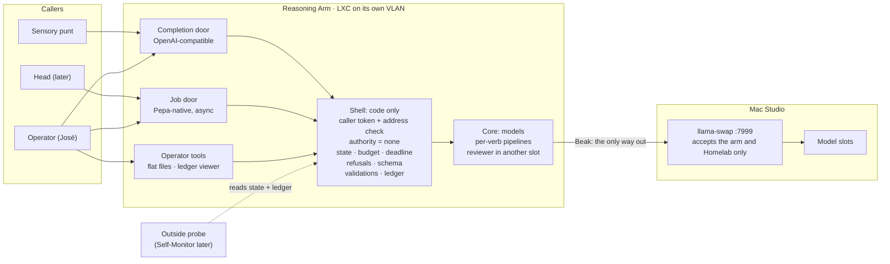

AI Generated
Human Curated

## Requirements (draft v0.2, 2026-11-03)

> 🟡 **Status:** draft for discussion, nothing settled.
>
> **What v0.2 is.** v0.1 (unpublished) plus José's 17 manual edits of 2 Nov (taken as proposals) plus a review of three outside analyses (Gemini, ChatGPT, Meta Muse) checked against the session record and the published pages. Appendix A says what changed and why, line by line.
>
> **Markers** (as in the session records): **Published** — already on ai4aging.org · **Decided (José)** · **Proposed (José)** — from José's messages or edits, not decided · **Suggested (Claude)** — not decided · **Open**. A new tag, **Review**, marks a suggestion that came from the outside analyses and was checked here.

The Pepa Reasoning Arm (PRA) has three doors (an OpenAI-compatible completion door, a Pepa-native asynchronous job door, an operator panel) in front of a deterministic shell that holds no operational credentials, with the models behind it in the Mac Studio's llama-swap slots. v0.2 tightens the contracts around the doors: who may call, how callers prove it, what each state means, what counts as a finished job, what a completion may become, and what the anchor check does and does not prove.

## Ground rules carried in

Published or decided; the feature list builds on them. Rows changed by José's edits or by the review are marked ✎ and explained in Appendix A.

| Rule | Where it comes from |
| --- | --- |
| The arm suggests; it never decides, orchestrates or executes. | Published |
| "Never executes" is structural: no operational credentials, no write tools, no route to the operations plane. The Beak enforces it, not a prompt. | Published |
| The Head owns the decision to plan; the arm never takes a planning request from a peer directly. | Published |
| Planning is asynchronous and never on the voice path. | Published |
| ✎ **One job at a time.** Availability is available, maintenance or unavailable; execution is idle, busy or draining. "Dead" is never a value the arm reports, because a dead process cannot report; an outside observer judges it. Published text says "the Head is the queue" — whether the arm gets a small queue at run is **Open** (see D-3). | Published (idle/busy, one job, Head is the queue, "no answer is its own outcome"); Proposed (José) maintenance and dead, queue at run |
| ✎ A submission carries task, supplied context, constraints, budget, and an authority marker that is always none. Any other value is refused in code before a model sees the request. | Published; Review (refusal in code) |
| ✎ **Four typed refusals:** not a reasoning task · missing information (naming what to supply) · doctrine forbids it · budget exhausted (partial work attached, marked not a deliverable). "Nothing available can achieve it" is no longer a refusal: it comes back as a done plan marked *infeasible*, with its reasons. | Published (five); Proposed (José) "reasoning", strike of "nothing available can achieve it"; Suggested (Claude) the infeasible result |
| ✎ No "can you do this?" pre-check. A help call is provided instead: it returns what the arm can do (the capability card for a verb), never a verdict on a task. | Published (no pre-check); Proposed (José) help equivalent |
| The requested verb travels apart from the content payload, so nothing in the content can change it. | Published (open questions) |
| A report is an artifact about sources, never a source. If it enters any store, it enters marked inferred. | Published |
| Conversation is a separate arm. | Published |
| Crawl (plain completions to the punt) → walk (one job in, one plan or refusal out, a human reads it) → run (house catalog, ontology, guardrails). | Published |
| A Pepa arm reflex: completed by the arm on its own through rules declared in advance, consulting neither the Head nor another arm. Arms may narrow it, never widen it. | Decided (José) — 1 Nov, §1.6 |
| ✎ The arm's ledger is the EVIDENCE-class record of what the arm observed and did: written once, owned by the arm, read by the Self-Monitor and Auditor arms. It is not the Architecture Design Ledger. | Decided (José) — 1 Nov, §1.8 |
| Loud failures: surfaced and ledgered, never a silent log line. | Decided (José) — 1 Nov, §6.3 |
| ✎ Abstention ("no fact / unclear / looked and found nothing") is a schema-valid output, enforced by a validator outside the model. "Forbidden" is not abstention; it is the doctrine-forbids refusal. | Published invariant; Review (separation) |
| ✎ Arms return events and/or the requested output; the Head's transition table decides what happens next. Every run ends done, punted or error. | Head Orchestrator Design, Option C (proposed); Proposed (José) wording |
| Facts are slots, not prose: evidence-derived values travel as typed slots filled by code after the last model step. | Candidate rule — Head Orchestrator Design |
| Bilingual by default: English, Spanish, Spanglish. | Published principle |

## The shape at a glance

Arm-peers (Memory, Knowledge, Human Sentinel…) have no door in v0.2. The Head reaches the completion door too, for plain answers.

## Feature list

Out of the original 52 features proposed, José dropped 6 from consideration early but their slot was not reassigned; forty-six features in six groups remain. Δ shows the change from v0.1: **new**, **chg** (changed), **=** (unchanged). Tier when built: 1 enforced in code, 2 declared and enforced by discipline or deployment, 3 designed not built, 4 identified not designed. Today every row is 3 or 4.

| ID                       | Feature                                                                                                                                                                                                                                                                                                                                         | Stage          | Marker                                                                                                                | Tier | Δ |
|--------------------------|-------------------------------------------------------------------------------------------------------------------------------------------------------------------------------------------------------------------------------------------------------------------------------------------------------------------------------------------------|----------------|-----------------------------------------------------------------------------------------------------------------------| --- | --- |
| **Doors**                |                                                                                                                                                                                                                                                                                                                                                 |                |                                                                                                                       | | |
| RA-01                    | Completion door: OpenAI-compatible chat completions, synchronous. Serves callers whose output reaches a person, or that the Head sits behind: the operator and the sensory punt now, the Head later. Not arm-peers.                                                                                                                             | Crawl          | Proposed (José) own endpoint and "human"; Suggested (Claude) the reading, compatible on this door only; Open: D-1     | 1 | chg |
| RA-02                    | Job door: Pepa-native typed API on the Agent2Agent (A2A) task lifecycle — submit (reply "accepted", with where to check), status, result, cancel, help; asynchronous, optional long-poll                                                                                                                                                        | Walk           | Proposed (José) precedent; Suggested (Claude) A2A                                                                     | 1 | chg |
| RA-03                    | State endpoint: availability (available, maintenance, unavailable) and execution (idle, busy, draining), answered at once. Busy and maintenance are fast answers (503 with reason and retry-after), not refusals. Dead is not a state: no answer at all means dead, judged from outside.                                                        | Walk           | Published (no answer is its own outcome); Proposed (José) maintenance, dead, fast busy; Suggested (Claude) dimensions | 1 | chg |
| RA-04                    | Capability card, in A2A vocabulary: verbs, models, refusal kinds, limits, versions, an example envelope per verb. The `help` call returns it.                                                                                                                                                                                                   | Walk           | Proposed (José) help equivalent; Suggested (Claude)                                                                   | 1 | chg |
| RA-05                    | Operator tools. Walk: flat files plus a ledger viewer on the command line. Run: the panel (settings, queue, ledger view).                                                                                                                                                                                                                       | Walk, then Run | Proposed (José) panel; Review (defer the panel)                                                                       | 2 | chg |
| RA-06                    | Caller registry with caller classes, **and caller authentication**: a per-caller token (only its hash stored in the arm) plus a source-address allow-list. Unknown or unauthenticated callers are refused before anything runs.                                                                                                                 | Crawl          | Suggested (Claude); Review (authentication)                                                                           | 1 | chg |
| RA-07                    | llama-swap on :7999 stays the engine room; Homelab tools keep using it directly; Pepa callers use RA-01 and RA-02                                                                                                                                                                                                                               | Crawl          | Suggested (Claude)                                                                                                    | 2 | = |
| RA-08                    | Model Context Protocol (MCP) face on the job door for local agents                                                                                                                                                                                                                                                                              | Later          | Suggested (Claude)                                                                                                    | 4 | = |
| RA-09                    | Outside liveness probe: a simple external check of the state endpoint and ledger that decides "dead". The Self-Monitor Arm takes it over once built.                                                                                                                                                                                            | Crawl          | Suggested (Claude); Review                                                                                            | 2 | **new** |
| **Envelope and results** |                                                                                                                                                                                                                                                                                                                                                 |                |                                                                                                                       | | |
| RA-10                    | One job envelope for every verb. An authority marker other than none is refused in code. (The marker exists so a request cannot smuggle authority in; the arm itself never holds any.)                                                                                                                                                          | Walk           | Published (fields); Suggested (Claude) the refusal                                                                    | 1 | chg |
| RA-11                    | Verb travels apart from content; content wrapped and bannered as data                                                                                                                                                                                                                                                                           | Walk           | Published                                                                                                             | 1 | = |
| RA-12                    | Budget plus one propagated deadline. Exhaustion refuses the job with reason budget exhausted; partial work is attached and marked *not a deliverable*.                                                                                                                                                                                          | Walk           | Published (budget, partial work); Head design (one clock); Proposed (José) question on transactions                   | 1 | chg |
| RA-13                    | Four typed refusals (not a reasoning task, missing information, doctrine forbids, budget exhausted), each telling the caller what to do next. A closed list.                                                                                                                                                                                    | Walk           | Published; Proposed (José) reasoning, strike; Suggested (Claude) closed list                                          | 1 | chg |
| RA-14                    | Four job outcomes: done, refused, error, cancelled. Maintenance is availability, not an outcome: a job is never accepted during maintenance.                                                                                                                                                                                                    | Walk           | Head design (three exits); Proposed (José) four; Suggested (Claude) the four                                          | 1 | chg |
| RA-15                    | Epistemic class stamped on every deliverable. Every claim carries its provenance or an explicit `no_source` marker. Plain completions carry the *unclassified* marker instead.                                                                                                                                                                  | Walk           | Published (reports); Proposed (José) acknowledgement, plain endpoint; Suggested (Claude) the markers                  | 1 | chg |
| RA-16                    | Results handed back, not kept beyond the retention windows in RA-47                                                                                                                                                                                                                                                                             | Walk           | Open on the published page; Suggested (Claude)                                                                        | 2 | chg |
| RA-17                    | Publication rule: only a validated deliverable is published as done. Work accumulates inside the job; nothing partial is promoted.                                                                                                                                                                                                              | Walk           | Suggested (Claude); Review                                                                                            | 1 | **new** |
| RA-18                    | Pending capacity: zero in walk. Busy answers at once (RA-03) and the caller retries. A small bounded FIFO is a run decision (D-3).                                                                                                                                                                                                              | Walk           | Published (Head is the queue); Review                                                                                 | 1 | **new** |
| RA-19                    | Dropped by José                                                                                                                                                                                                                                                                                                                                 | N/A            | N/A                                                                                                                   |
| **Services**             |                                                                                                                                                                                                                                                                                                                                                 |                |                                                                                                                       | | |
| RA-20                    | Completion with a guardrail profile chosen by caller class (operator: log only; sensory-punt: conversation profile; head: set per call). The response carries the *unclassified* marker and the job ID. A completion can never itself establish a Memory or Knowledge fact (RA-44).                                                             | Crawl          | Proposed (José); Review (marker, prohibition)                                                                         | 1 | chg |
| RA-21                    | Plan: one plan, **or** a plan marked *infeasible* with reasons (the means do not exist), **or** a typed refusal                                                                                                                                                                                                                                 | Walk, then Run | Published; Suggested (Claude) infeasible                                                                              | 1 | chg |
| RA-22                    | Analyze: crosscheck, review, compare and extract over material the caller supplies                                                                                                                                                                                                                                                              | Walk           | Proposed (José); Suggested (Claude) modes                                                                             | 1 | = |
| RA-23                    | Four validations on every analysis. **Anchor** (code): the cited span exists verbatim. **Source** (code): it belongs to the declared document and §. **Verdict** (reviewer model, then a human): the quote supports the finding. **Timing** (code plus dates): later evidence has not superseded it. Only the first two are guaranteed by code. | Walk           | Suggested (Claude); Review                                                                                            | 1 | chg |
| RA-24                    | Imagine: hypotheticals, scenarios, fixture drafts; stamped hypothetical. Project-only in v0.2.                                                                                                                                                                                                                                                  | Walk           | Proposed (José); Review (project-only)                                                                                | 1 | chg |
| RA-25                    | Explain: supplied records rendered for a named audience and language; facts travel as slots filled by code                                                                                                                                                                                                                                      | Walk           | Proposed (José)                                                                                                       | 1 | = |
| RA-26                    | Research: investigate a question against declared sources, report with provenance                                                                                                                                                                                                                                                               | Run            | Published (candidate); reach Open                                                                                     | 1 | = |
| RA-27                    | Replay and bench: re-run a finished job with another model or prompt version. Record input hash, prompt version and model configuration so a replay is reproducible.                                                                                                                                                                            | Walk           | Suggested (Claude); Review                                                                                            | 2 | chg |
| RA-28                    | Text-to-speech (pepa-tts, :8100) listed on the capability card and written to the ledger                                                                                                                                                                                                                                                        | Crawl          | Published (RV3); Suggested (Claude)                                                                                   | 2 | = |
| RA-29                    | Scoreboard: plans and analyses a human accepted, per verb and model. Deferred past the first two services.                                                                                                                                                                                                                                      | Run            | Published (plans); Suggested (Claude); Review (defer)                                                                 | 2 | chg |
| **Inside**               |                                                                                                                                                                                                                                                                                                                                                 |                |                                                                                                                       | | |
| RA-30                    | Deterministic shell, model core: intake, authentication, checks, state, budget, refusals, validation and ledger are code                                                                                                                                                                                                                        | Walk           | Suggested (Claude)                                                                                                    | 1 | = |
| RA-31                    | Fixed per-verb pipelines in walk; an agent loop only for planning with read-only tools at run                                                                                                                                                                                                                                                   | Walk, then Run | Suggested (Claude)                                                                                                    | 3 | = |
| RA-32                    | Structure-first chunking by headings and § numbers; original offsets and section IDs preserved through every step                                                                                                                                                                                                                               | Walk           | Suggested (Claude); Review (offsets)                                                                                  | 1 | chg |
| RA-33                    | Reviewer model in a different slot as a check. Disagreement is a result, kept as two attributed claims; agreement is never proof. Two models may not fit beside the large slot at once: measure, and fall back to the small slot or a swap.                                                                                                     | Walk           | Suggested (Claude); Review                                                                                            | 1 | chg |
| RA-34                    | Schema-validated outputs, abstention included; validator outside the model                                                                                                                                                                                                                                                                      | Walk           | Published invariant                                                                                                   | 1 | = |
| RA-35                    | Frozen, versioned prompt prefix per verb. At run: frozen prefix, then the stable catalog (byte-identical, sorted by entity ID), then per-job content, so the prompt cache holds.                                                                                                                                                                | Walk, Run      | Published (frozen prefixes); Suggested (Claude); Review (layout)                                                      | 1 | chg |
| RA-36                    | Planted-error test fixtures for analyze: wrong quotes, unsupported claims, contradictions, superseded evidence                                                                                                                                                                                                                                  | Walk           | Suggested (Claude); Review                                                                                            | 2 | **new** |
| RA-37                    | Dropped by José                                                                                                                                                                                                                                                                                                                                 | N/A            | N/A                                                                                                                   |
| RA-38                    | Dropped by José                                                                                                                                                                                                                                                                                                                                 | N/A            | N/A                                                                                                                   |
| RA-39                    | Dropped by José                                                                                                                                                                                                                                                                                                                                 | N/A            | N/A                                                                                                                   |
| **Safety and record**    |                                                                                                                                                                                                                                                                                                                                                 |                |                                                                                                                       | | |
| RA-40                    | No operational credentials, no write tools, no route to the operations plane. Enforced by deployment: the Beak between VLANs, **and** a filter on the Studio itself (pf or llama-swap's own allow-list) for hosts on the Studio's own subnet, which the Beak never sees.                                                                        | Walk           | Published; Suggested (Claude) the Studio filter                                                                       | 2 | chg |
| RA-41                    | The arm's ledger: JSON Lines, append-only, UUIDv7 job keys, correlation IDs, content hashes (not content), processing chain and versions. Field names follow the OpenTelemetry GenAI conventions proposed in the 3 Oct observability recon.                                                                                                     | Crawl          | Decided (José) the ledger; Suggested (Claude) the fields; Review                                                      | 1 | chg |
| RA-42                    | Loud failures to the caller, the operator tools and the ledger; household people only through the Sensory Arm                                                                                                                                                                                                                                   | Walk           | Decided (José); Suggested (Claude) routes                                                                             | 1 | = |
| RA-43                    | The arm's only reflexes: refusals, budget kills, drain under memory pressure — nothing outside the arm                                                                                                                                                                                                                                          | Walk           | Suggested (Claude) under the Decided reflex base class                                                                | 1 | = |
| RA-44                    | An interface prohibition, not a policy line: nothing the arm produces — completions included — enters Memory or Knowledge except marked inferred or hypothetical, by another arm's decision                                                                                                                                                     | Walk           | Published (reports); Suggested (Claude); Review                                                                       | 2 | chg |
| RA-45                    | Settings in flat files under version control; every change is a ledgered event, kept distinct from job events; fail-closed defaults shown and explained                                                                                                                                                                                         | Walk           | Suggested (Claude); Review                                                                                            | 1 | chg |
| RA-46                    | Health read from outside: the Self-Monitor Arm (and the RA-09 probe until then) reads the state endpoint and ledger, never the arm's own account                                                                                                                                                                                                | Walk           | Suggested (Claude)                                                                                                    | 2 | = |
| RA-47                    | Three retentions: the ledger is append-only and permanent; job results are kept until collected or 7 days; completions are returned and not kept; supplied content has the shortest retention and the ledger stores only its hash                                                                                                               | Walk           | Suggested (Claude); Review                                                                                            | 2 | **new** |
| RA-48                    | Dropped by José                                                                                                                                                                                                                                                                                                                                 | N/A            | N/A                                                                                                                   |
| RA-49                    | Dropped by José                                                                                                                                                                                                                                                                                                                                 | N/A            | N/A                                                                                                                   |
| **Host**                 |                                                                                                                                                                                                                                                                                                                                                 |                |                                                                                                                       | | |
| RA-50                    | Shell in an LXC on its own VLAN; the Mac Studio stays a pure inference server. Host (pve2 or pve3) is decided when resource needs and network rules are known.                                                                                                                                                                                  | Walk           | Suggested (Claude); Open: D-4                                                                                         | 2 | chg |
| RA-51                    | Repository `prsws/pepa-reasoning-arm` — simple, not clever                                                                                                                                                                                                                                                                                      | Walk           | Suggested (Claude)                                                                                                    | 2 | = |
| RA-52                    | Completion never waits behind a job. Either the punt has a model slot the job pipelines do not use, or the pipelines' many small calls leave room for it. Measure on the Studio before choosing.                                                                                                                                                | Crawl, Walk    | Suggested (Claude)                                                                                                    | 2 | **new** |

## Interfaces

Its own endpoints; OpenAI compatibility only on the completion door. Everything new speaks a small Pepa-native job API on the A2A task lifecycle (submitted, working, completed, failed, cancelled, rejected), so a typed envelope, typed refusals and an asynchronous lifecycle do not have to bend into the chat shape.

| Door | Who uses it | Shape | Notes |
| --- | --- | --- | --- |
| Completion (RA-01) | Operator, sensory punt, later the Head | `/v1/chat/completions`, `/v1/models`, synchronous | The punt moves by changing a URL and adding its token. Every call is ledgered; the reply carries the unclassified marker. |
| Job (RA-02) | Operator now; the Head when it exists | Submit → "accepted, check here" → status → result; cancel; help | Busy and maintenance answer at once. |
| State and card (RA-03, RA-04) | Callers, the probe, the Self-Monitor Arm | Two read-only endpoints | No work submitted. |
| Operator tools (RA-05) | José | Flat files and a ledger viewer; the panel at run | Operator-only, house network only. |

**Caller classes (RA-06).**

| Class | Example | Doors | Verbs |
| --- | --- | --- | --- |
| operator | José | Completion, job | All |
| head | The LangGraph Head, once built | Completion, job | All |
| sensory-punt | PSA's `call_external_llm` | Completion only | Completion |

**Note**: _Arm-peer is removed in v0.2. Another arm that needs reasoning goes through the Head, as published._

**What stays outside.** llama-swap on :7999 remains the Studio's engine room for Homelab tools. Once the punt has moved to the completion door, Pepa hosts are blocked from :7999 by two mechanisms, because they live on two different networks: the Beak for hosts on other VLANs, and a filter on the Studio itself for hosts on its own subnet (RA-40).

**Naming.** *Caller class* replaces "authority level" for the guardrail dial. The record now uses "authority" in three senses (a mandate to act, the EVIDENCE **authority class** of a record, and the envelope marker that is always none), so the glossary should fix all three.

## State model (RA-03, RA-14)

| Dimension | Values | Who reports it |
| --- | --- | --- |
| Availability | available · maintenance · unavailable | The arm, at once |
| Execution | idle · busy · draining | The arm, at once |
| Job outcome | done · refused · error · cancelled | The arm, on the job |
| Dead | — | Never the arm. An outside probe judges it from no answer or a stale ledger. |

*Degraded* (a slot missing, the reviewer unavailable) is shown as extra health detail on availability, not a fourth axis. *Superseded* is a Head concept and waits for the Head.

## Services

| Verb | Goes in | Comes out | Epistemic class | Good first job |
| --- | --- | --- | --- | --- |
| completion | Messages from a registered caller | One answer | Unclassified; never storable as fact | The Sensory Arm's punt, as today |
| plan | Task, context, constraints, budget | A plan, or a plan marked infeasible, or a refusal | Proposal | Sequencing the PSA re-adoption work |
| analyze | A question or rubric plus the material | Findings, each with verdict, anchor and four validations | Interpretation, anchored | Cross-check the 2 Nov session record's Summary against its Running record |
| imagine | A premise and a frame | Scenarios, variants, drafts | Hypothetical | What-if walks through the eight use-case EPCs (project only) |
| explain | Records, audience, language, level | An explanation whose facts all come from the records | Interpretation; facts as slots | A `pepa_verify` failure event in plain Spanish |
| research | A question and permitted sources | A report with provenance per claim | Interpretation about sources | Reading-list triage |

**Analyze, in detail.** Modes: crosscheck (each claim gets one verdict: supported, contradicted, partly supported, not found, stale), review, compare, extract (marked inferred). The 2 Nov failure is a harness problem: a small model given a long page in one pass loses the middle. The pipeline splits by structure, extracts one claim per Summary bullet, finds candidate entries by § and keyword in code, asks the model for a verdict and a quoted span, then checks. The validation ladder (RA-23) is honest about its limits: a real quote can still be misread, so the anchor check proves the quote exists and the source check proves where it is from, while the verdict and timing checks still need the reviewer and the reader. A verdict whose quote is not found becomes *unanchored*.

**Explain keeps fail-closed slots.** Values arrive as slots filled by code after the model writes, and the output fails if the model restates a value. A validator that tried to tolerate restatement would miss values written out in words ("veinte", "las dos y media"), and the Head design's stricter rule is the 68 °F lesson.

## Job envelope and result

| Envelope field | Holds | Marker |
| --- | --- | --- |
| `job_id` | UUIDv7 set by the caller (idempotency) | Suggested (Claude) |
| `caller_id` | Registered caller. The proof is the token in the request header, not a field. | Suggested (Claude); Review |
| `verb`, `mode` | The verb is a field of its own, never inferred; `mode` for sub-kinds | Published; Suggested (Claude) |
| `task`, `content[]`, `constraints` | Instruction; material with source and provenance, wrapped as data; limits | Published |
| `budget`, `deadline` | Done condition and one propagated clock | Published; Head design |
| `model`, `language`, `audience` | Preference from the class's allow-list; for explain and refusal text | Published; Suggested (Claude) |
| `authority` | Always `none`; anything else refused in code | Published; Suggested (Claude) |

| Result field | Holds |
| --- | --- |
| `status` | done · refused · error · cancelled |
| `refusal` | One of four kinds, plus what to supply next when information is missing |
| `deliverable` | Typed by verb; for a plan, possibly marked infeasible |
| `epistemic_class` | proposal · interpretation · hypothetical · unclassified |
| `claims[]` | Each claim with provenance or `no_source`; for analyze, the anchor, verdict and four validation results |
| `assumptions`, `uncertainties`, `invalidators` | Confidence about the result in words, not a self-rated score |
| `partial_work` | Only on a budget-exhausted refusal; marked *not a deliverable* |
| `processing_chain`, `versions`, `input_hash` | Model, quantization, slot, prompt version, shell version, hash of the input |
| `budget_used`, `timings` | What the job cost |

## Inside the arm

A deterministic shell around a model core. Plain Python for the shell; fixed pipelines per verb in walk; LangGraph only where a verb needs a loop (planning with read-only tools at run). Models are checks, not routers: the caller declares the verb, so there is nothing to classify, and inferring intent at this layer runs into the no-inferred-intent directive. A reviewer in a different slot, preferably a different model family, checks the first model's findings (RA-33). Every model output is validated against its schema; after a capped number of retries the job ends in error, and free text is never passed through. Whether rapid-mlx's constrained output is good enough to replace validate-and-retry is to be measured on the Studio.

## Where it runs

Leaning, unchanged: the shell in an LXC on a Proxmox host in the Pepa stack, on its own VLAN; models stay behind llama-swap on the Studio. The deciding reason is that it turns "never executes" into a firewall rule. Bare on the Studio puts the arm on the same subnet as Home Assistant, so the rule would rest on discipline; a VM on the Studio takes memory from the model slots on a 64 GB machine. The cost of the LXC is a second box that can take the arm down, which is acceptable because it is off the voice path and fails loudly. The host (pve2 or pve3) waits for resource needs and network rules.

## Operator tools and settings

Walk: policy in flat files under version control, a command-line ledger viewer, and a kill switch (drain, then stop). Run: the panel (state and queue, engine room, callers, services, guardrail profiles, retention, messages, scoreboard, ledger). Either way, every change is a ledgered event with old value, new value, who and when, kept apart from job events. Defaults fail closed and say why.

## Build order (Review)

1. Shell, caller authentication, state endpoint, ledger (RA-30, RA-06, RA-03, RA-41).
2. Completion door; move the punt and confirm PSA's calling contract is untouched (RA-01, RA-20, RA-52).
3. Close :7999 to Pepa hosts with both mechanisms; start the outside probe (RA-40, RA-09).
4. Job door with one verb: analyze/crosscheck on the 2 Nov session record, with planted-error fixtures (RA-02, RA-22, RA-23, RA-32, RA-36).
5. Reviewer slot and replay bench (RA-33, RA-27).

Deferred until two services have proved their contracts: the panel, MCP, an internal queue, LangGraph, the scoreboard, research beyond supplied sources.

## Pending Decisions

| # | Question | Suggested answer | Why |
| --- | --- | --- | --- |
| D-1 | What does "human callers" in RA-01 mean? | Callers whose output reaches a person or sits behind the Head; no arm-peers | Keeps the punt working and stops arms chaining unlogged reasoning through a chat endpoint |
| D-2 | Operator as interim submitter | Yes, recorded as a dated development exception | Honest about the published rule instead of quietly reinterpreting it |
| D-3 | Queue at run: the Head (published) or a small bounded queue in the arm (José's edit) | Keep the Head as queue unless a concrete need appears | Priority and supersession live where authority lives; changing it needs a dated entry on the page |
| D-4 | Where the shell runs | LXC on its own VLAN; host later | The firewall rule is the enforcement |
| D-5 | Close :7999 to Pepa hosts | Yes, after the punt moves, with both mechanisms | One mechanism leaves a gap on the Studio's own subnet |
| D-6 | Auditor Arm and analyze | No use of this arm's models by the Auditor for now | Shared models share failures |
| D-7 | Imagine's reach | Project only | Household-facing storytelling edges into the Conversation Arm |
| D-8 | LangGraph | Plain Python now; at run only for the planning loop | Same library as the Head, so the lease rule can carry over |
| D-9 | Retention | RA-47 | Supplied content may include health talk (D-11) |
| D-10 | First build slice | Build order above | Each step is testable alone and none breaks the punt |
| D-11 | "Nothing available can achieve it" as a plan result instead of a refusal | Yes | It comes from a real attempt and deserves provenance. Your strike suggests this was the intent: please confirm. |
| D-12 | Publishing the changes | The four-refusal list, the state model and any queue change need a dated entry on the Reasoning Arm page | They change published text |

## Appendix A — what changed from v0.1

| Source | Item | Change in v0.2 |
| --- | --- | --- |
| José's edit 1 | States; "dead"; caller-is-queue struck | State model (three dimensions); dead judged from outside; published "Head is the queue" restored in the text and flagged as Open (D-3) |
| José's edit 2 | Authority marker struck | Kept: `authority: none`, other values refused in code |
| José's edit 3 | "Reasoning"; "nothing available" struck; "???" on budget | Adopted "reasoning"; the strike read as a plan result (D-11); budget exhaustion refuses with partial work not promoted |
| José's edit 4 | "A -help equivalent" | RA-02/RA-04: `help` call returns the capability card |
| José's edit 5 | "Job queue" at run | Open (D-3), zero pending in walk (RA-18) |
| José's edit 6 | "What is EVIDENCE-class record?" | Answered in the ground rule, from §1.8 |
| José's edit 7 | Abstention "/ forbidden" | Abstention kept epistemic; "forbidden" routed to the doctrine refusal |
| José's edit 8 | "events and/or the requested output" | Kept |
| José's edit 9 | RA-01 "human callers" | Read as D-1; arm-peer class removed |
| José's edit 10 | RA-02 "find precedent/best practices" | A2A task lifecycle |
| José's edit 11 | RA-03 maintenance, dead, fast busy | RA-03 |
| José's edit 12 | RA-10 "(explain)" | Explained in RA-10 |
| José's edit 13 | RA-12 "debatable… transactional" | RA-12, RA-17: only validated deliverables are published |
| José's edit 14 | RA-13 five struck, "as identified" | Closed list of four (RA-13) |
| José's edit 15 | RA-14 four states, maintenance? | Four outcomes; maintenance is availability |
| José's edit 16 | RA-15 acknowledgement of missing citations; plain endpoint | `no_source` marker; unclassified marker on completions |
| José's edit 17 | RA-20 "(explain)" | Explained in RA-20 |
| Review | Caller identity vs authentication | RA-06 |
| Review | Completion as a governance bypass | RA-15, RA-20, RA-44 |
| Review | Anchor check overclaims | RA-23 validation ladder |
| Review | Queue semantics | RA-18, D-3 |
| Review | Transactional publication | RA-17 |
| Review | Ledger and retention | RA-41, RA-47 |
| Review | Reviewer memory limit | RA-33 |
| Review | Prompt cache layout | RA-35 |
| Review | Planted-error fixtures | RA-36 |
| Review | Same-subnet bypass of the Beak | RA-40 |
| Review | Completion starved by jobs | RA-52 |
| Review | OTel field names | RA-41 |
| Declined | Explain restating values with after-the-fact validation | Kept fail-closed slots |
| Declined | Meta Muse: revert "events and/or the requested output", keep the authority edits softened, keep all five refusals | Kept your wording on the first; kept `authority: none`; adopted a closed list of four with infeasible as a plan result |
| Sent elsewhere | `ha_control` allow-list fails open; `verify` lost on a Home Assistant restart; service-channel confirmation | Sensory Arm backlog (already in the 2 Nov record) |
| Rejected | Gemini's build plan ("asynchronous completions"; planning bound to Head transitions) | Contradicts the synchronous completion door and Option C |

## Abbreviations

For more Pepa terms refer to the [Pepa Glossary](https://github.com/prsws/pepa-glossary)

| Short | Spelled out                                                             |
| --- |-------------------------------------------------------------------------|
| A2A | Agent2Agent protocol — vocabulary and task lifecycle, not its transport |
| EPC | Event-driven process chain                                              |
| FIFO | First in, first out                                                     |
| JSONL | JSON Lines                                                              |
| LXC | Linux container, as run on Proxmox                                      |
| MCP | Model Context Protocol                                                  |
| OTel | OpenTelemetry                                                           |
| PRA, PSA | Pepa Reasoning Arm, Pepa Sensory Arm                                    |
| RA-nn | (R)easoning (A)rm feature IDs                                           |
| RV3, RV4 | Reasoning Arm versions in the PRA Version History                       |
| VLAN | Virtual local area network                                              |

