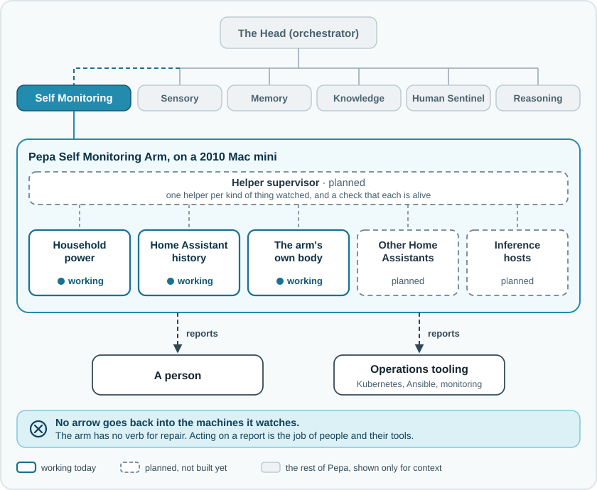

AI Generated
Human Curated

A system that watches over an older person at home earns trust only if it notices when it is the one failing. So Pepa now has an arm whose only job is to watch the system itself, and it starts on a Mac mini from 2010.

## Why Pepa has to watch itself

Pepa lives in a real house. It reads sensors, remembers things, listens for a wake word and answers a person who may depend on it. Every one of those jobs runs on ordinary computers, and ordinary computers fail: a power cut, a full disk, a model server that quietly stops answering, a smart plug that flips the wrong way.

The dangerous failures are the silent ones. If Pepa stops listening and nothing says so, the person at home keeps trusting a system that is no longer there. The other arms are busy doing their jobs; none of them is placed to notice when another one goes quiet. So I gave that job to an arm of its own.

## What the arm is, and what it is not

The Pepa Self Monitoring Arm (PSMA) is designed as a small supervisor that sits under the Head, Pepa's orchestrator. It does not do every check itself. It is meant to look after a set of small helpers, one for each kind of thing being watched: the power supply, the Home Assistant instances, the machines that run the language models. Only the power helper exists today, plus a live dashboard of the inference machines that records nothing; the supervisor that keeps helpers alive is still on paper.

It has two halves. The always-on half is plain, deterministic code: it keeps an inventory, records what it sees and, once built, will notice when something goes silent. The second half acts only when asked, to report, to characterize or to double-check a reading. Language models can help with that second half, but they are never the only thing standing between a problem and the person.

The most important rule is the one it leaves out. **The arm has no verb for repair.** It watches, records and reports, and it reports to two kinds of reader: a person, and the operations machinery that person already runs, such as Kubernetes, Ansible or a monitoring stack. It never restarts a service, flips a switch or shuts a machine down on its own. Acting on a problem is the job of those tools and the people behind them, and it is not Pepa's job.

There are two reasons. A monitor that can also fix things can also break things, and in a home with an older person in it that trade is not mine to make silently. The second reason is about growth. A system that can change the machines it watches can widen its own reach one reasonable-looking repair at a time, because each fix justifies a little more access, and a language model in the loop makes that drift easy to miss. An arm that cannot act keeps its capabilities at what was designed and reviewed, and the tools that do act already bring their own review, audit and rollback.

## Choosing a body: a 2010 Mac mini

The arm needs a body, a machine that stays on, sits on a wired network and outlives the experiments around it. My first choice was an Orange Pi Zero 2W, a small single-board computer. It ran on WiFi, and I did not want a tiny board deciding how big the arm could become.

The replacement was already on a shelf: a Mac mini from mid-2010. It was never going to win a benchmark. It earned the job on other grounds:

- **Wired gigabit network**, so no WiFi in the path of the thing that watches everything else.
- **A plain solid-state drive that passed its health check**, so the storage is not the first thing to worry about.
- **Debian 13 with the stable kernel**, so it changes slowly and predictably.
- **A past life as a workhorse.** Years ago this same machine ran 28 containers for another project of mine.
- **Zero cost.** If the arm runs on a 2010 Mac mini, it runs on whatever you have in a closet. That matters for a project meant to be rebuilt by other families.

It had one flaw worth telling: after a power cut, a Mac mini of this age does not turn itself back on. The firmware forgets. A one-line setting written at every boot fixes it, and I tested it the honest way, by pulling the plug while it ran. It came back by itself. The drive still remembers 31 unexpected power losses from its earlier life, which is a good reminder of why this arm exists.

## Better hardware, more capability

The Mac mini is a floor, not a ceiling. Its processor is an old 2-core chip that lacks instructions modern software increasingly assumes, and that already has consequences. Better hardware would add real capability to the arm:

- **More software runs.** Many container images now assume instructions this chip lacks, so every tool I consider has to be checked first. A current processor removes that check.
- **More helpers and longer memory.** With 8 GB of RAM the arm has room for what it runs today. More memory means more helpers at once and more history kept close.
- **The second half gets stronger.** When the arm needs a language model to characterize a reading, it would have to borrow a bigger machine on the network. A more capable body could do more of that work itself.
- **Room to grow into other jobs.** A faster body could also take on heavier helpers, such as ones that analyze logs, without crowding out the watching.

The design does not depend on any of this. Each helper is a small service or container with its own settings, so moving the arm to better hardware means copying those settings and the records to a new machine, not rebuilding the idea. Start with what you have; upgrade when the arm outgrows it.

## What the arm covers today

Three areas are working now. All of them record and none of them act.

| Area | What it does now | What is still missing |
| --- | --- | --- |
| Household power | Reads the battery backup that keeps the network gear and the arm itself running. It takes a reading every 30 seconds, and every 5 seconds once the mains power is out. It also logs power lost, power restored, low battery and replace-battery events. The log lives in its own database and does not depend on Home Assistant. | No alerts yet. Nothing shuts the arm down when the battery runs low. The date the battery was installed is not recorded yet. |
| Home Assistant history | One of the house's Home Assistant instances now writes its recorder to a database on the arm instead of a local file, so its history no longer lives only inside that instance. The database accepts connections only from that instance and from the arm's own logger. | No decision yet on how long to keep history. No backup of the database. The older history in the previous file was left where it was. |
| The arm's own body | The Mac mini starts by itself after a power cut and keeps a record when its logger stops or restarts. If a gap appears in the readings, the log says whether the machine rebooted or was stopped cleanly. | Nothing yet notices when the arm itself goes quiet. That is the job of the watchdog described below. |

The log is append-only. The account that writes it can add rows but cannot change or delete them, so what the arm recorded stays what it recorded.

## How it does it: what is installed on the Mac mini

Nothing here is exotic. Every piece is ordinary, open software that runs on the machine under its own container or service, so any one of them can be replaced without touching the others.

| Layer | What is there                                                                                                                                                                      | What it does for the arm |
| --- |------------------------------------------------------------------------------------------------------------------------------------------------------------------------------------| --- |
| Operating system | Debian 13 with its stable kernel                                                                                                                                                   | A slow-moving base that I do not have to babysit. |
| Start-up setting | A small service that tells the firmware to power the machine on after a power cut ([configuration on GitHub Gist](https://gist.github.com/prsws/f82a47fac34554fd9d7d1eb3b9cb278d)) | Brings the arm back by itself after an outage. |
| Container engine | Docker, from Debian's own packages                                                                                                                                                 | Runs the database, the Home Assistant instance and the other web tools as separate containers. |
| Home Assistant | One Home Assistant instance in a container, with its Matter server beside it                                                                                                       | The instance whose history the arm now stores. |
| Database | PostgreSQL 18 in a container, with its data kept apart from the container itself                                                                                                   | Holds the arm's records: that Home Assistant history and the power log. It accepts connections only from the two programs that need it. |
| Battery backup service | Network UPS Tools: a driver that reads the battery backup over USB, and a server that offers those readings to the network                                                         | The source of every power reading. It only reports; it is not set to shut anything down. |
| Battery backup dashboard | PeaNUT, a small web page in a container                                                                                                                                            | A live view of the battery backup for a person to look at. |
| Power logger | A small Python program that runs as a service under its own account, with most of the system closed off to it, and restarts itself if it stops ([code on GitHub](https://github.com/prsws/pepa-psma-ups-logger)) | Reads the battery backup every 30 seconds, or every 5 once the mains power is out, and writes the readings and events down. It writes to a local file first and then to the database, so a database outage does not lose readings. |
| Fleet dashboard | LLM Fleet Monitor, an open-source tool of mine that uses only Python's standard library                                                                                            | Shows which machines that run language models are up and what they have loaded. It shows current state only: it records nothing and sends no alerts, and its list of machines needs tidying. |
| Disk health | smartmontools, with Debian's stock settings                                                                                                                                        | Installed, but not yet wired into the arm. |

Two habits run through the list. The arm's own pieces only read and record. And secrets such as database passwords live in files that only the account that needs them can read, never in the code or in anything published.

## What is planned

Everything in this table is design or intention, not running software.

| Area | What it will do | Open question |
| --- | --- | --- |
| Silence detection and an exception ledger | Notice when something that should report has gone quiet, and write each exception down so it can be reviewed later. | How long a silence counts as a problem for each kind of thing. |
| Helper supervisor | A small supervisor that runs one helper per kind of thing watched and checks that each helper is alive. | Which helpers come first. |
| Watching other Home Assistant instances | Read-only observation of the other Home Assistant systems in the house. | How much each one may be asked to report. |
| Pepa Watchdog | A separate, small watcher that checks the arm, so the arm is not the only one vouching for itself. This answers the question of who watches the watcher. | Where it runs and how it reaches a person if the arm is down. |
| Clean shutdown on low battery | Let the arm power down cleanly before the battery is empty. | Who holds the authority to shut things down. I have deliberately left that open. |
| Backups and a firewall | Back up the arm's database and restrict who can reach the machine. | Schedule and destination. |
| Retention policy | Decide how long each kind of record is kept. | How much history is worth keeping for the person being cared for. |
| Inference hosts | Turn the existing fleet dashboard into a helper that records what it sees and notices when a machine goes quiet, once its list of machines is tidied. | What counts as healthy for a machine that is busy by design. |
| Zigbee coordinator | Decide where the radio that talks to the house sensors should run. | Whether it belongs on the arm at all. |
| A route from the Head | Let the Head ask the arm a question when something needs a deeper look. | What the arm may answer without a person in the loop. |

One rule runs through all of it. The arm has no verb for repair. It observes, records and reports, to a person or to the operations tooling a person already runs, which is built to act on a report. That handoff to outside tooling is not designed yet.

## Where this stands

The arm is young. It has a body, a durable place to write things down, and one working watcher, the one that reads the battery backup. The rest of the design is on paper, and I have tried to keep this article honest about which is which.

I will update this section as areas move from the planned table to the covered one.

*Pepa is an experimental, self-hosted research project. It is not a medical device, it does not diagnose or treat anyone, and nothing in the Self Monitoring Arm should be relied on as a safety system.*
