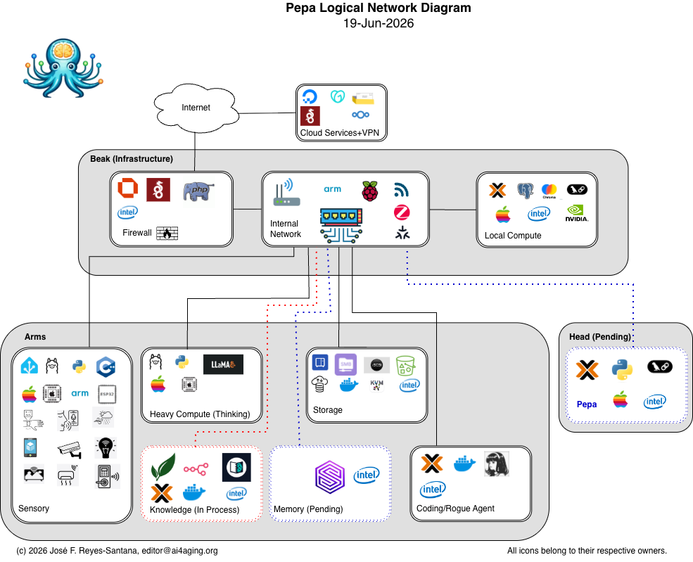

_Diagram is still valid as of 5-Sep-2026._ Legend pending.

_27-Oct-2026: not yet depicted — the second Home Assistant instance for human telemetry (Oct 2026), a VM on a Proxmox node. See [The Sensory Arm](/arms/sensory/the-sensory-arm/)._