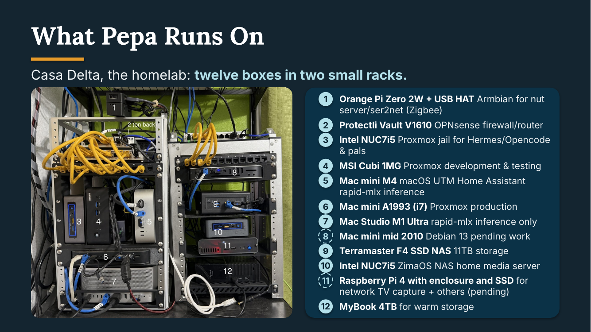
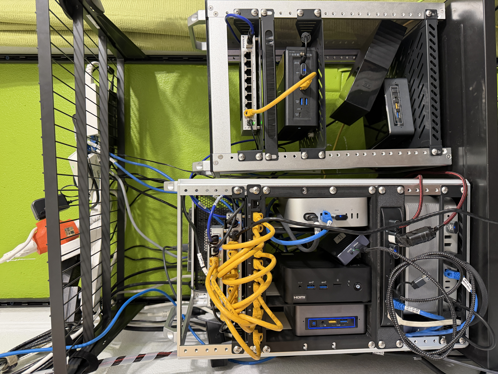
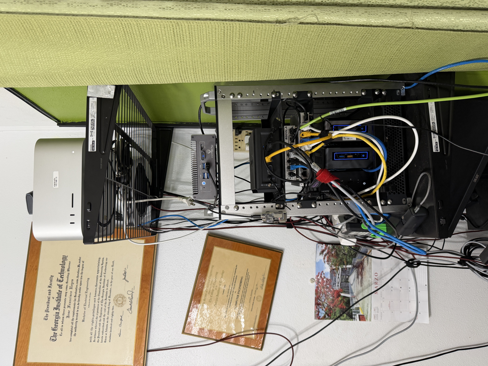
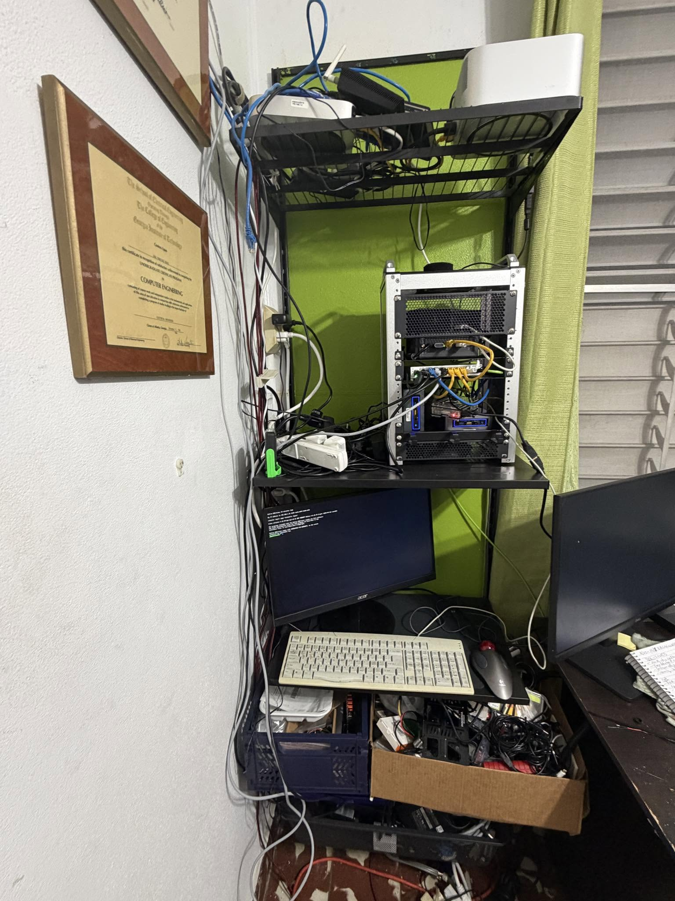
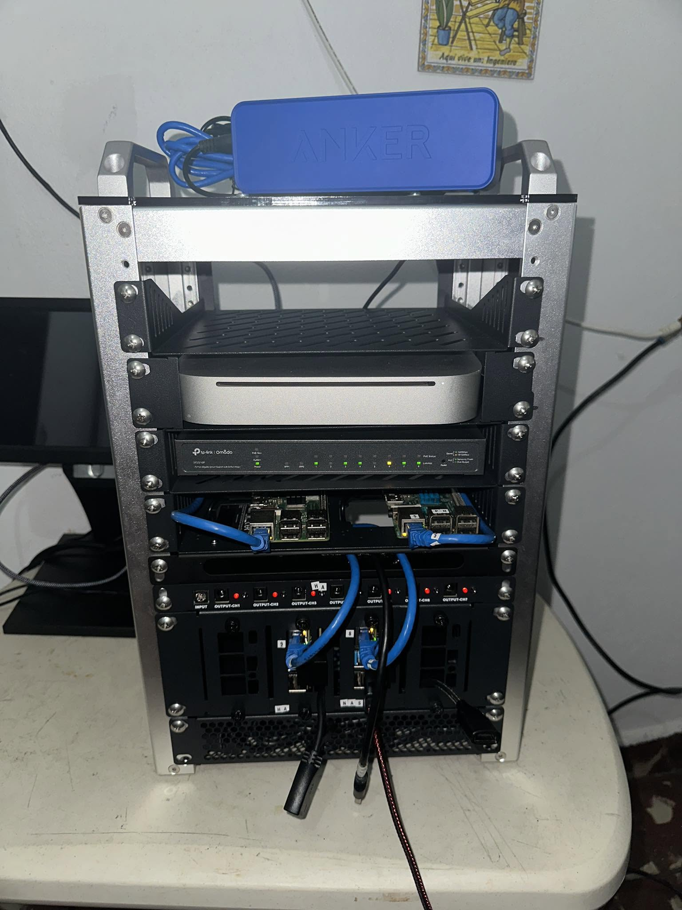
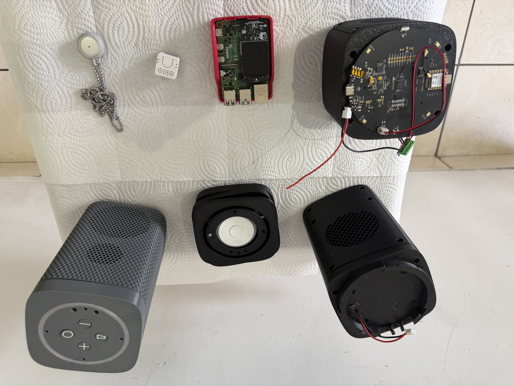
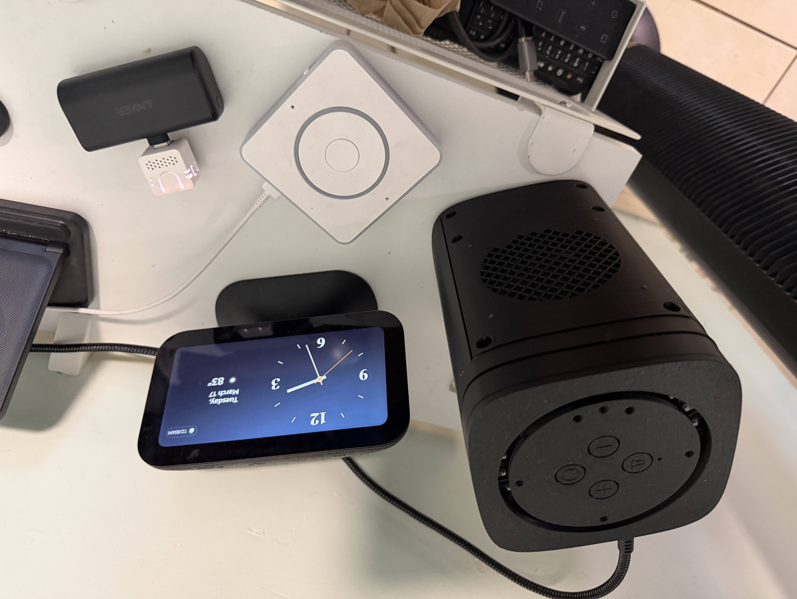

AI Assisted&nbsp;

Here's the path we've taken — and are still traveling (updated Oct-2026), because we're maybe a third of the way up a very long ladder and nothing is permanently settled. Each step below shows two things: the affordable rung we started on, which remains a valid starting point for you, and the gear we've evolved to after a year of blood, sweat and painful $ mistakes.

Don't let our current hardware scare you; we didn't start there and neither should you. Climb at your own pace and budget — you can stop at any rung and still have something useful. Detailed docs are in progress which will expand on these topics. Read it slowly, there's a lot to unpack here because this is not written for newbies. Meantime please document your own work to compare notes with us.

_All the specific brands/models mentioned below are our current operational choices but you make your own. They're listed for your shopping convenience and were purchased out of our own pocket. Painful $ mistakes were made so think carefully when sourcing stuff to make substitutions. We shopped at Amazon, eBay, FB Marketplace, Best Buy and locally. There are no affiliate links so Google them up and find the deals you can because the AI datacenter boom raised prices wholesale._

_This is real and working. See pictures at the bottom._

### **0. Foundation (Network)**&nbsp;&nbsp;Mandatory

You need a stable home network.

**Minimum:** Internet + WiFi 
**Recommended:** wired backbone with VLANs

| Layer | Requirement                                                 | Our choice                                                             | Budget start                                                                                |
|---|-------------------------------------------------------------|------------------------------------------------------------------------|---------------------------------------------------------------------------------------------|
| Wired backbone | ≥1 Gb/s; 2.5 Gb/s preferred; 10G not needed                 | 2.5 Gb/s                                                               | 1 Gb/s                                                                                      |
| Router / firewall | True L3 hardware router, or OPNsense/pfSense                | OPNsense on Protectli Vault V1610 (AMI BIOS, not coreboot)             | a) Consumer router, e.g. TP-Link Archer BE6500  b) any 2-NIC i3 mini PC                 |
| VLANs | Required, for traffic separation, prioritization & security | Trunked to/from router to backbone/distribution switches & AP's        | Flat LAN, beware of crowding with traffic                                                   |
| WiFi access points | Multi-SSID with SSID-to-VLAN mapping                        | 2× used Grandstreams: GWN7664, GWN7662, PoE-injected, trunked, 4 SSIDs | a) Consumer router for flat LAN b) Engenius EAP300, Cisco WAP4410N, etc. for multi-SSID |
| IoT radios | WiFi 2.4 GHz on its own VLAN, Zigbee, Matter                | WiFi through the APs; Sonoff Zigbee dongle; IKEA Dirigera for Matter   | WiFi only                                                                                   |

**SSIDs:** main, guest, IoT, cameras

**Don't:**
- Rely on an L2 or quasi-L3 switch alone as the router, you need true inter-vlan access
- Use a router-on-a-stick unless you can't afford better (a Raspberry Pi is acceptable there _but used to be affordable, no longer_)

**Matter/Thread:** seen maturing enough in 2026H2 to take seriously but YMMV.

> _Pepa is infrastructure. If the network is flaky, everything else is noise._
>

---

### **1. Sensory Base (Home Assistant)**&nbsp;&nbsp;Mandatory

 Home Assistant provides the human-facing interface to Pepa; install it on dedicated hardware.

**Minimum**: a used mini PC running HAOS **Recommended**: an efficient machine you can grow into, running HAOS as a VM

| Layer | Requirement                                                   | Our choice                                                                               | Budget start                                                                                                          |
|---|---------------------------------------------------------------|------------------------------------------------------------------------------------------|-----------------------------------------------------------------------------------------------------------------------|
| Host| Dedicated machine; NUC-class mini PC, i5 or better, 8 GB+ RAM | Mac mini M4 24GB, shared with the speech, vector DB and local LLM services from steps 2–3 | Any used NUC-class mini PC -- no Pi's unless GPIO needed. We started with  Pi's then moved to a used 2017 NUC7i5 8GB. |
| Install | 	HAOS as an appliance — bare metal or a VM                    | HAOS as a UTM virtual machine -- drawback is no passthrough USB, solved externally       | a) HAOS bare metal b) LXC/VM in existing Proxmox, no extra h/w needed                                             |
|Sensors | 	Inexpensive: motion, door, power, switches                   | Presence, door, leak and motion sensors; smart switches and plugs                        | A few smartplugs, motion & door sensors                                                                               |
| Devices | Only buy devices that meet open standards (Zigbee, Matter/Thread). Read their cloud tie-ins really closely and expect needing the vendor app for configuration.                                                              | IKEA, TP-Link, Sonoff                                                                    | Whatever is on sale locally                                                                                           |

**Important** Configure/wire the devices so that the house keeps working even if the network is down. _**Must always have manual control of the house.**_

> _Without sensory input, Pepa is blind and Home Assistant is an excellent platform for that._
>

---

### **2. Sensory Intelligence Layer (Home Agent app)**&nbsp;&nbsp;Mandatory

> _We recommend that for fastest results you start where we did -- [Anton Radlein's Home Agent app](https://github.com/aradlein/hass-agent-llm)._ 
> The Pepa Sensory Arm code builds upon it but it's experimental and may not always work. Stay tuned.
> 

To make the sensory arm semi-autonomous, install the Home Agent app through [Home Assistant Community Store](https://www.hacs.xyz/) (HACS) on Home Assistant.

> **Note**: Starting with Home Assistant v2026.11, HACS will be integrated into the main HA application as its "Marketplace".
> 

- Connect to a cloud LLM to start — cheap, fast to set up, and fine for learning what an LLM-driven home even feels like
- Begin experimenting with automations + LLM intent interpretation
- Optionally install an MCP server app on it so you can use Claude, Hermes or other agents to manage it -- **THIS IS DANGEROUS AND NOT PEPA's WAY**

| Layer | Requirement | Our choice | Budget start |
|---|---|---|---|
| Agent | Home Agent app, installed through HACS | "Pepa Sensory Arm", our development version of Home Agent | Home Agent as published |
| Local model | Small, local, good at tool calls | Gemma 4 E2B (4-bit) | Any small Gemma-class model |
| Model server | On the Home Assistant box, OpenAI-compatible | rapid-mlx on the same Mac mini | Ollama on the same box |
| Escalation | What's too heavy goes up, not improvised | Punted to our Mac Studio (step 6) | Nothing until step 6 |

**Why local:** no cloud, no per-token bills, and everything keeps working when the internet doesn't.

**Heads-up:** getting a small model to behave takes real harness work (that's a story for the detailed docs), but the hardware ask is modest: it fits in the same box you already bought.

> _This completes the house side of the Sensory arm: it perceives and acts. The meaning of what it senses gets made further up._
_You can stop here and enjoy an excellent, smart home automation system without further development work, just maintenance, but without Pepa._
>

---

### **3. Voice Interface**&nbsp;&nbsp;Interface Expansion

The voice interface is Pepa's main connection with its elderly user during normal daily operation. As such, it's mission-critical and in many ways:
- microphone and speaker electronics design and placement
- initiates a conversation cycle that triggers STT &rightarrow; inference &rightarrow; action &rightarrow; TTS
- collects voice utterances and metadata to be consumed by Pepa's higher functions
- must only activate on purpose: push-to-talk or reliable wake word only. No open mic without justified reason.

Our roster:

| Satellite | Class | Hardware | Notes                                                                                                                                                                                                                                                                                                                                                                  |
|---|---|---|------------------------------------------------------------------------------------------------------------------------------------------------------------------------------------------------------------------------------------------------------------------------------------------------------------------------------------------------------------------------|
| M5Stack Atom Echo | Cheap starter | 1 mic, tiny speaker | Barely audible but very portable, so it can cosplay as a Federation combadge or any other senior-friendly wearable                                                                                                                                                                                                                                                     |
| Home Assistant Voice Preview Edition | Official Nabu Casa gear | 2 mics, louder speaker | Better hardware, works out of the box                                                                                                                                                                                                                                                                                                                                  |
| Seeed ReSpeaker XVF3800 on a Raspberry Pi 4 | Capture workhorse | 4-mic array, XMOS XVF3800 voice processor, USB | Our ground-truth audio capture platform. Runs Linux Voice Assistant over the ESPHome protocol. Requires Linux setup, an enclosure and a speaker, work in progress                                                                                                                                                                                                      |
| FutureProofHomes Satellite1 | "High end" circuit | 4 mics, 20 W amp, presence + ambient sensors | Requires ESPHome and coding know-how, plus a 3D-printed enclosure, an audiophile-quality speaker and assembly. Or else you can just buy it ready to go, the less fun choice. This is the type needed for unintrusive monitoring of the senior                                                                                                                          |
| PiSugar Whisplay HAT on a Raspberry Pi Zero 2W | Portable push-to-talk | 2 mics, WM8960 audio codec, small onboard speaker (external supported), 1.69" 240×280 LCD, programmable button, RGB LEDs | Pi Zero sized, so it can be carried. Push-to-talk only: the button is the trigger and there's no wake word. The screen can show status or what Pepa said. Requires Linux setup, a small enclosure and some coding. Our first try on an Orange Pi Zero 2W didn't work out; it's on a Pi 4 testbed now                                                                   |
| Omi pendant (BasedHardware) | Bought, worn | 2 mics, Nordic nRF5340 (Bluetooth LE) plus a Wi-Fi chip, RGB LED, 150 mAh battery; open-source hardware (MIT) | Worn, not built: an off-the-shelf answer to the portable satellite we kept trying to make ourselves. Under evaluation: the pendant is in benchtesting with its own app, and the goal is to send its audio to Pepa instead once the firmware developer kit arrives. No speaker is documented, so replies would come from a room satellite or the phone or smart glasses |

> The Orange Pi Zero 2W was repurposed as host opi and now handles UPS monitoring via nut-server and soon Zigbee mesh coordinator host through ser2net.
>

| Layer | Requirement | Our choice | Budget start |
|---|---|---|---|
| Speech-to-text | Local, always on | Apple's on-device speech recognition (wyoming-apple-speech) on the Mac mini | Whisper on the same box |
| Text-to-speech | Local, always on, a voice that fits | Piper on the Mac mini; a second engine under audition | Piper |
| Acceleration | No GPU tower needed | Apple Silicon | Your CPU, with smaller models |
| Remote reach | Optional | iPhone over VPN; CarPlay in the car | None |

**History:** we first ran speech on a gaming laptop with an nVIDIA card under Windows. It worked, but the power bill and the fan noise repurposed it for occasional odd jobs as soon as we got the mini. Whisper (large-v3-turbo) then ran on the Mac mini until July 2026, when speech-to-text moved fully on-device with the Apple Foundation Siri model.

**Bonus we didn't plan for:** the same voice pipeline reaches the car. The iPhone connects home over VPN, and Pepa talks through the car speakers via CarPlay. [Watch the video](https://youtu.be/d8FX92hwtlM?si=HsbyfAhzNSibPuZ4)

> _Voice is not typing. It will break things. That's the point._
>

---

### **4. Storage Node (Persistence)**&nbsp;&nbsp;Capability Expansion

Set up a NAS or some other network storage solution.

- SMB and S3-style storage for all your data; skip the fancy distributed filesystems (ZFS, Ceph, etc.) — that's costly complexity you don't need and won't want to maintain
- Run auxiliary processes on it, but lightly
- Don't overload the NAS with non-Pepa data and apps, get a 2nd one for that

| Layer | Requirement | Our choice                                                                      | Budget start                                                    |
|---|---|---------------------------------------------------------------------------------|-----------------------------------------------------------------|
| Pepa storage | SMB and S3-style; quiet, low power | TerraMaster F4 SSD, all solid state: it sips power and makes no noise           | Any small NAS -- OpenMediaVault is great with generic x86 boxes |
| Backups | Automated, for everything in step 5 | Proxmox Backup Server, hosted on the NAS                                        | Proxmox's built-in backups to a NAS share                       |
| Non-Pepa data | On a second box, not on Pepa's NAS | A second NAS (a repurposed NUC7i5 running ZimaOS) for Jellyfin and family media | Whatever you got, until things become affordable again          |

**Load limit:** besides file duty, the Pepa NAS runs Proxmox Backup Server, and that's as loaded as we'll let it get.

**History:** Jellyfin used to run on the TerraMaster too. In October 2026 it moved to the second NAS, following the "get a 2nd one" rule above. Persistent storage is one place where we started at the rung we're still on.

> _Persistent, reliable and boring storage is the key to Pepa's longevity and usefulness._
>

---

### **5. Cognitive Backend (Local Compute)**&nbsp;&nbsp;Capability Expansion

Set up a small server with Proxmox VE — any used mini PC with 16GB+ RAM will do. A Proxmox alternative we're testing along is WolfStack. _Do not go crazy setting up clusters that you don't know if you'll need; minimize complexity._

- Run Pepa's code and auxiliary apps
- Run your databases here, each in its own lightweight container
- Add vector storage (SurrealDB)
- Begin experimenting with orchestration (LangGraph, your own Python code, etc.)
- Other supporting services as you accumulate them (UPS monitoring, MQTT, DNS, inventory, task tracking, etc.)

| Layer | Requirement | Our choice | Budget start |
|---|---|---|---|
| Host | Cheap, silent, low-watt; runs a stack of small services | Proxmox on a used Intel-era Mac mini, with unprivileged containers and VMs | Proxmox on any used mini PC |
| Long-term memory | One engine for graph, vector and metadata together | SurrealDB — the design we're building toward | Whatever database you already know |
| General database | Relational, with vectors when needed | PostgreSQL + pgvector: tried for long-term memory and parked; now a scratchpad and the Human Sentinel Arm's record store | Whatever database you already know  |
| Knowledge | Your documents, searchable and citable | paperless-ngx and Open Notebook | paperless-ngx |
| Human telemetry | Its own instance, collection only (step 7) | A Home Assistant VM | Skip until you need it |
| Radio bridge | The Zigbee radio can live anywhere | A serial-over-network bridge | Radio plugged straight into the HA box |
| Extras | Lightly | A few quality-of-life apps | — |

**Moved out:** ChromaDB (the sensory arm's working memory) now runs on the Mac mini with Home Assistant. NUT, which watches the UPS, moved to the Orange Pi that is also becoming Pepa's Self-Monitor Arm's experimental body.

**Heads-up:** the 20-year memory horizon requirement is the hardest arm, and the detailed docs will show the scars.

> _These are Pepa's vital organs, and where memory starts to exist outside HA for all arms to access._
>

---

### **6. Heavy Compute (LLMs)**&nbsp;&nbsp;Capability Expansion

Choose your path:

- Cloud: API-based LLMs — the cheap start. No hardware to buy, but your household's words and telemetry leave the house. Fine for learning, wrong for the mission.
- Local:
  - Apple Silicon with as much unified memory as you can afford, or
  - an nVIDIA GPU box (mind the power draw — see the gaming laptop lesson in step 3)
- Experiment with Ollama, LM Studio, llama.cpp, MLX, CUDA, pure Python, etc.

| Layer | Requirement | Our choice                                                             | Budget start                                                               |
|---|---|------------------------------------------------------------------------|----------------------------------------------------------------------------|
| Host | Plenty of fast memory; idles near zero | A used 2022 Mac Studio M1 Ultra, 64 GB unified memory                  | Any machine with enough VRAM (unified or not) for one mid-size model < 40B |
| Model server | Local, OpenAI-compatible | rapid-mlx (MLX)                                                        | Ollama                                                                     |
| Models | Bigger than step 2's, swapped as needed | A Qwen-class 27B as the main model, with smaller models in extra slots | One mid-size model                                                         |
| Front door | One endpoint for every client | llama-swap in front of the model slots (under evaluation)              | Clients call the model server directly                                     |
| Other endpoints | Non-LLM jobs, run on demand | Piper text-to-speech for narration clips                               | None                                                                       |
| Callers | Hired muscle, not the boss | Step 2's inference punt, Hermes/OpenCode agents, others                | Step 2's inference punt                                                    |

**Why this box:** mostly electricity and build quality. In actual Pepa usage, it idles near zero, spikes for inference and goes back to sleep: an always-on brain a Puerto Rico power bill can live with. And Apple hardware quality is top tier.

**Not the boss:** when the small model in step 2 hits something too heavy, the harder question gets routed here.

**History:** it started out serving models through Ollama.

> _Heavy compute is the reasoning muscle and determines how smart, independent — and private — your Pepa becomes. The Head that decides who does what is orchestration software, not hardware — that story is still being written._
>

---

### **7. Separation of Concerns (Highly Recommended)**&nbsp;&nbsp;Operational Maturity

Keep your system stable:

| Layer | Requirement | Our choice                                                                                                                                                                             | Budget start |
|---|---|----------------------------------------------------------------------------------------------------------------------------------------------------------------------------------------|---|
| House instance | Production, stable, boring on purpose | Home Assistant alone on its Mac mini; only upstrem updates and approved experimental results are installed                                         | One Home Assistant box |
| Human-telemetry instance | Its own production instance, collection only | A Home Assistant VM on a Proxmox node, collecting from the watch, blood pressure cuff and the like, and doing nothing else                                                             | Skip until you collect health data |
| Experiments | Separate hardware; breaking it can't break the house | Quarantined on the Proxmox nodes: new agents, memory designs and harnesses, a development Home Assistant instance, and the NUC that used to be our main HA box, now demoted to lab rat | A spare mini PC or a Proxmox container |
| Backups | Automated, for every VM and container | Proxmox Backup Server snapshots, nightly to the NAS                                                                                                                                    | Proxmox's built-in backups to a NAS share |
| Power | A UPS, so brownouts don't corrupt anything | Two UPSes, monitored over NUT                                                                                                                                                          | One UPS on the house box |

**Why the second production instance:** a misbehaving house integration should never be able to touch a health record. See [The Sensory Arm](/arms/sensory/the-sensory-arm/).

**Electrical testing, courtesy of the grid:** the UPSes ride through the power blinks that Puerto Rico's grid generously provides for testing purposes. Will eventually be included in Pepa's Self Monitor Arm.

> _If you break Pepa, your house should still work._
>

---

### **What You Get at the End**

If you followed this blueprint, you will have climbed the first rungs:

That's a minimal, working Pepa scaffold — the first third of the ladder, which is exactly where we are. The very first Pepa runs in our house today and it needs lots more work.

_The rest is up to you, so go for it and let us know what you build._

---
[Email your comments to the editor](mailto:editor@ai4aging.org)

---
### Pictures

_Pepa's rack, rung by rung. Same mission, evolving hardware — proof you can start small._

_Oct-2026 — First stable configuration_

_Jul-2026 — On the way to stability...._

_Mar-2026 — Minirack v3: first fully working Pepa scaffold._

_Dec-2025 — Minirack v2: NAS & Mac Studio added but HA running on NUC7i5, no OPNsense and no Proxmox._

_Jun-2025 — Minirack v1: Raspberry Pi's, a Mac mini 2010 and hope._

---
_Our current voice satellite roster (Oct-26) in various stages of development._

_The original voice satellites c. Mar-2026, plus an Amazon Echo Show 5 with Alexa+ as benchmark and goal — when we dump (maybe reflash?) it, that means Pepa is ready for its mission._
<Image src={pepaFoto2} alt="" width={1200} height={1200} />

